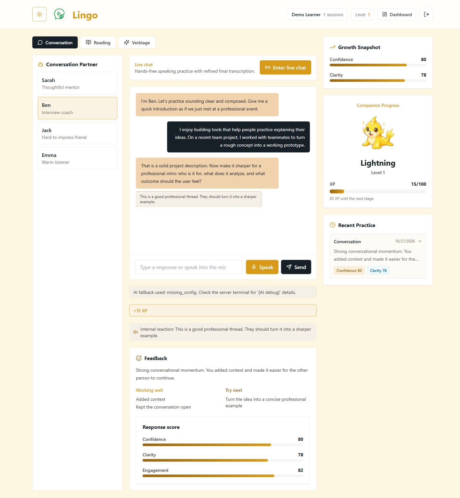
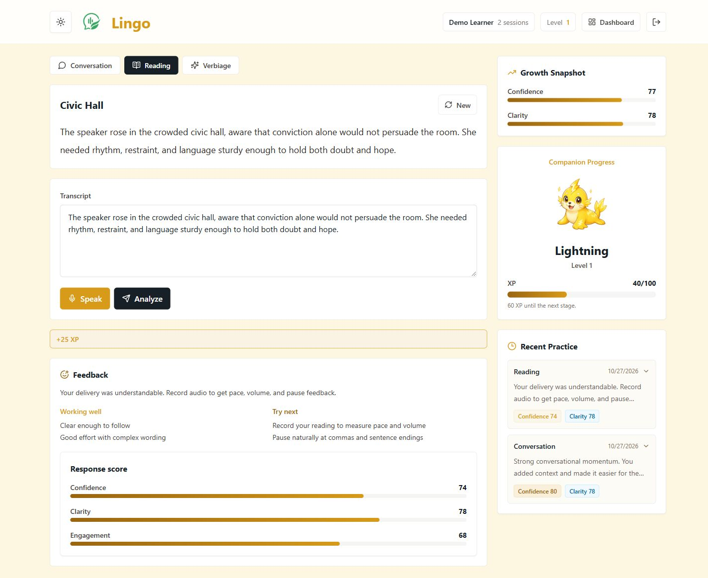

# Lingo — AI-Powered Speech Confidence Coach

**Second place at KeanUHackThis · Built by a three-person team in 24 hours.**

Lingo helps people rehearse conversations, read aloud, and practice clearer word choice. A React interface connects to an Express API for feedback, saved practice history, and an elemental companion that grows with practice.

## A look inside

Actual local screenshots using a sample account and typed practice text. **API keys were disabled: replies and scores below are deterministic demo output, not live AI evaluations or evidence of learning outcomes.** The growth snapshot and history show only this sample account's completed exercises.

**Conversation practice:** choose a partner, respond, and review feedback alongside companion progress.



**Reading feedback:** review a passage and transcript, then see feedback and saved practice history. This example uses pasted text; no microphone measurements were collected.



## Features

- **Conversation practice:** four partners (Sarah, Ben, Jack, and Emma), typed responses, recorded audio, and a browser-dependent hands-free mode.
- **Reading and word-choice practice:** built-in passages and prompts, transcript-based feedback, and phrase notes. Recorded reading/verbiage can also use browser-measured pace, volume variation, and pauses.
- **Progress and personalization:** JWT login, MongoDB activity history and score averages, an eight-question companion survey, XP, three companion levels, and element-aware light/dark themes.
- **Account dashboard:** profile and account status. All speech-practice activities are available to signed-in users; no payment is required.

## Architecture

```text
React 18 + Vite + Tailwind (localhost:5173)
  ├─ Practice, history, companion, account screens
  ├─ Browser audio capture / analysis and optional speech recognition
  └─ HTTP API + JWT in localStorage
          ↓
Node.js + Express (localhost:5000 by default)
  ├─ Authentication: bcrypt + JWT
  ├─ Practice services: provider requests or local demo feedback
  ├─ MongoDB / Mongoose: User and Activity documents
  └─ Devnet subscription verification + atomic payment history update
```

`client/src/components/` contains the screens; `server/src/routes/` exposes the API; `server/src/services/` handles AI, voice, and payment verification. Local audio analysis lives in `client/src/utils/audioAnalysis.js`.

| API | Purpose |
| --- | --- |
| `GET /api/health` | Health check |
| `POST /api/auth/signup`, `/login` | Create an account / sign in |
| `GET /api/auth/me`; `POST /api/auth/survey`, `/mic-calibration` | Profile and onboarding |
| `GET /api/conversation/bots`; `POST /api/conversation/turn` | Conversation practice |
| `GET /api/reading/passage`; `POST /api/reading/analyze` | Reading practice |
| `GET /api/verbiage/prompt`; `POST /api/verbiage/analyze` | Word-choice practice |
| `POST /api/voice/transcribe`, `/speak` | Recorded-audio transcription / speech output |
| `GET /api/history`; `GET /api/me/subscription` | Saved activities / subscription status |
| `POST /api/subscription/verify` | Verify an account-bound devnet payment |

All routes except health, signup, and login require authentication. `server/src/routes/cortex.js` and `snowflakeSqlService.js` are unused prototype files: `/api/cortex` is **not mounted**, and the running app does not need `snowflake-sdk`.

## Local setup

Use **Node.js 24** (validated with 24.14.1) and a local MongoDB instance. No paid API or hosted database is needed for typed demo practice.

```sh
git clone https://github.com/NotSllaim/KeanHack-SNN.git
cd KeanHack-SNN
npm ci
npm ci --prefix server
npm ci --prefix client
```

The existing `npm run install:all` command is also available after installing root dependencies; it runs `npm install` in both subprojects.

1. Copy `.env.example` to `.env` (`cp .env.example .env`, or `Copy-Item .env.example .env` in PowerShell).
2. Start local MongoDB and set `MONGODB_URI` to a local/development database. The example uses `mongodb://127.0.0.1:27017/lingo_dev`.
3. Replace `JWT_SECRET` with a random local secret. Generate one with `node -e "console.log(require('crypto').randomBytes(32).toString('hex'))"`.
4. Leave provider credentials and merchant-wallet fields blank for the demo.
5. Run `npm start` (an alias for `npm run dev`), then open `http://localhost:5173`.

The API defaults to port **5000**, matching `.env.example` and the client's fallback URL. If occupied, set both `PORT=5001` and `VITE_API_URL=http://localhost:5001/api`. Keep `CLIENT_ORIGIN` aligned with Vite's actual URL; `CLIENT_ORIGINS` optionally supplies a comma-separated allow-list. Restart after changing environment variables.

The server loads `server/.env` before root `.env`; existing process variables take precedence. Prefer a single root `.env` to avoid conflicting overrides. Vite also reads the root environment directory. **Every `VITE_*` value is public in the browser bundle.** Never put private keys, tokens, or database credentials there. `.env` and `.env.*` files are ignored; `.env.example` is the tracked exception.

### Optional providers: what the code actually does

| Path | Selection and fallback |
| --- | --- |
| Conversation | Calls Snowflake Cortex directly, regardless of `AI_PROVIDER`. Missing configuration, request failure, or unusable output produces local rule-based replies and scores. It does **not** retry Google. |
| Reading / verbiage | `AI_PROVIDER=gemini` selects Google. Otherwise, configured Snowflake wins; Google is selected only when Snowflake configuration is absent. Missing configuration or a null provider result produces local feedback. A Snowflake failure does **not** trigger Google failover. Google network exceptions/timeouts can surface as API errors. |
| Recorded speech to text | ElevenLabs Scribe when configured; without its key, returns a fixed, explicitly marked demo transcript. Provider errors propagate. |
| Speech output | Deepgram first, optionally ElevenLabs TTS if Deepgram fails; the client attempts browser speech synthesis when no audio is returned. Live speech recognition separately depends on browser support. |

- **Snowflake:** `SNOWFLAKE_ACCOUNT`, `SNOWFLAKE_TOKEN`, and optional `SNOWFLAKE_MODEL` (default `openai-gpt-4.1`). The active integration uses the Cortex REST inference endpoint.
- **Google:** `GEMMA_API_KEY` and `GEMMA_API_URL`. These are historical variable names: the example URL selects **Gemini 2.5 Flash Lite**, not Gemma. The URL determines the actual model; `GEMMA_MODEL` helps decide whether to send a Gemini thinking-budget option.
- **Voice:** see `.env.example` for `ELEVENLABS_STT_MODEL_ID`, optional ElevenLabs TTS voice/model, and Deepgram voice overrides. Provider availability and model access depend on your account; live provider calls were not part of this cleanup's validation.

## Optional hackathon category experiment

The Solana devnet subscription-status prototype was a **last-minute addition for a hackathon category**, not a core part of Lingo. It is not required to run or evaluate the speech-practice experience. Leave merchant-wallet settings blank and use all practice modes without payment.

<details>
<summary>Devnet experiment: setup and implementation notes</summary>

This is a test-token demonstration, not production billing: no mainnet payments, recurring charges, or paid-support service. Blank RPC settings use public devnet; no paid Helius account is required. If exploring it separately, use only a devnet wallet/test tokens and matching merchant, mint, and price values in server and `VITE_*` settings. The UI displays 30 days, matching the example duration.

The client signs a transfer with an account-bound memo. The server checks devnet, transaction success, signed sender, account memo, mint, recipient, and exact amount. A unique signature index and atomic update reject reuse. The unused `/api/auth/upgrade` route was removed; a Pro status without a future expiry is inactive. Practice routes do not gate access by tier.

Old transactions without the memo cannot be claimed. Historical cross-account duplicate signatures would block index creation until reviewed. No shared database was migrated. Legacy scripts under `server/scripts/` are not setup steps and do not reverify historical payments. Live wallet/on-chain validation was not performed and is not a prerequisite for the portfolio demo.

</details>

## Tests and validation

```sh
npm test          # Node's built-in runner; mocked providers/RPC, no keys required
npm run build    # Production frontend bundle; does not start or bundle the API
```

Tests cover XP boundaries/awards, score averaging, provider selection and fallback behavior, subscription expiry, payment rejection, account binding, and duplicate claims. An optional integration test uses a **disposable local** MongoDB database named `lingo_test_*`:

```powershell
$env:TEST_MONGODB_URI='mongodb://127.0.0.1:27017/lingo_test_portfolio'
npm test
Remove-Item Env:TEST_MONGODB_URI
```

Without that variable, the database integration test is skipped. It refuses remote hosts and removes only its own test users.

Portfolio cleanup validation: clean installs and the production build passed; 16 tests passed with isolated local MongoDB. Local browser checks covered signup, survey, logout/login, typed conversation, reading, word-choice feedback, persisted history/XP, dashboard, inactive subscription renewal access, and devnet labeling. Installation reports an existing React Native/React peer warning from the wallet dependency tree; the build reports a large JavaScript chunk and stale Browserslist data. Dependency upgrades and bundle optimization were outside this cleanup.

## Demo limitations

- Local fallback scores are heuristics/constants. Reading feedback without audio has no measured pace or volume; word-choice fallback always includes fixed example phrases, even when absent from the response. These are demonstrations, not validated speech assessments.
- The AI receives transcripts (plus audio metrics for reading/verbiage), not raw audio for phonetic analysis. Avoid claims of validated pronunciation accuracy, measured confidence improvement, or a trained custom model.
- Only conversation exposes an explicit fallback indicator in the UI. Reading/verbiage can display deterministic feedback without a separate provider badge.
- Live model quality, actual microphone transcription/playback, and wallet signing/on-chain settlement remain unverified here. No real payments were made. Use sample content for demos; provider-enabled use transmits transcripts or recordings to the configured services.
- Authentication and payments are hackathon prototypes. Practice endpoints do not gate access by tier, and production operational/security hardening is outside this portfolio cleanup.

## Team contributions

Built together during the 24-hour KeanUHackThis hackathon. Roles below were confirmed by Shane; they are not inferred from commit counts.

| Teammate | Contribution areas |
| --- | --- |
| **Shane Ruggirello** | Frontend implementation, UI/UX design, application structure and user flow, and research into AI/voice providers. |
| **Nolan Hughes** | Backend implementation and user-flow design. |
| **Nurbu Llama** | Backend implementation and research, feature scoping, and deployment for review. |

This portfolio cleanup adds documentation, local demo screenshots, subscription safeguards, and automated tests after the hackathon. Those additions are not presented as work completed during the original 24 hours.
